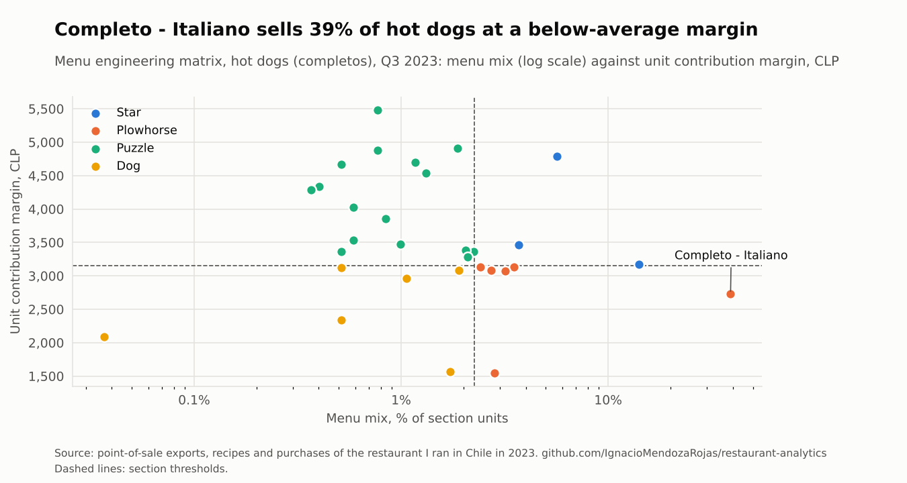
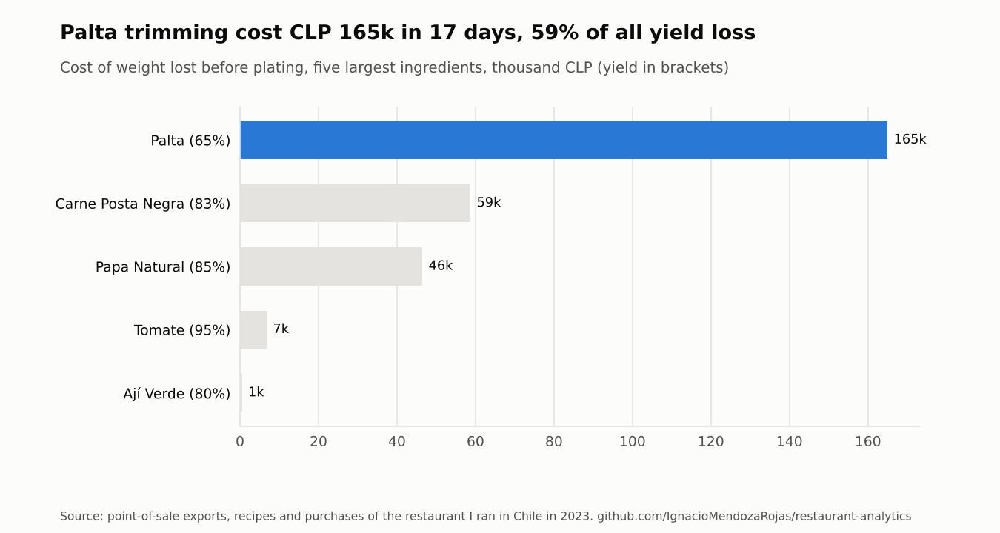
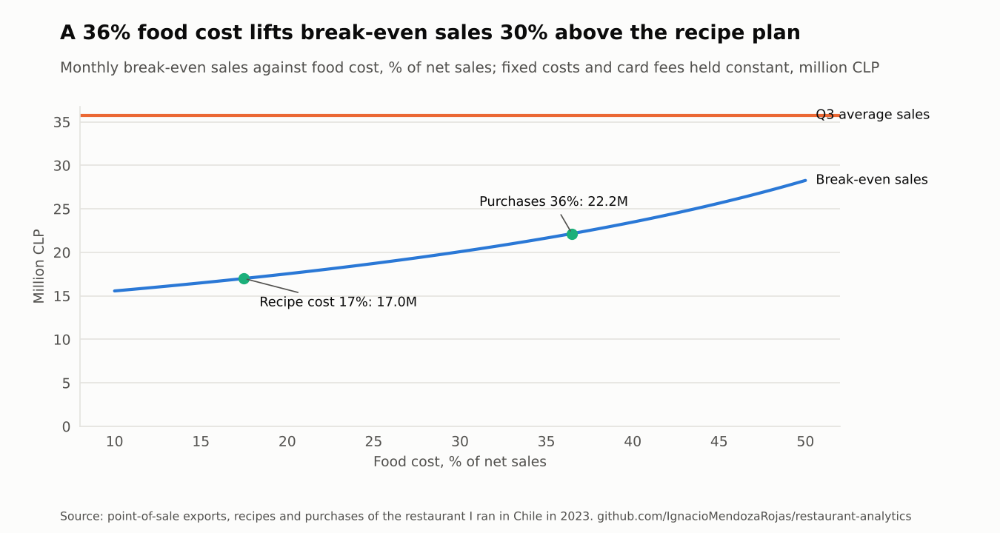

# Restaurant Analytics: Menu Engineering, Yield and Break-even

[](https://github.com/IgnacioMendozaRojas/restaurant-analytics/actions/workflows/ci.yml)


**Corporate finance and unit economics.** Menu engineering, margin leakage and break-even on real operating data, the same toolkit as FP&A for a business unit.

## What this shows

| Task in FP&A or business control | Where it is done here |
|---|---|
| Decide which products to keep, reprice or drop | Menu engineering by section: popularity against unit contribution |
| Find where margin leaks | Yield-adjusted theoretical usage against actual purchases |
| Set a sales target and a margin of safety | Break-even under recipe-cost and observed-cost scenarios |
| Turn raw system exports into reporting | Python pipeline over the point-of-sale exports, replacing an Excel/VBA routine |

## Context

In 2023 I ran the day-to-day of a fast-casual restaurant in Chile: hot dogs (*completos*),
sandwiches, pizza, sushi, fries to share and fresh juices, about 260 items on the menu.
I set up the daily reporting on top of the POS exports (Excel/VBA): sales by product,
recipe costs, yields, cash closing and the monthly P&L.

This repository rebuilds that analysis in Python on the **real operating data**, to answer
three questions every restaurant owner should be able to answer:

1. **Which dishes earn their place on the menu?** Menu engineering by section.
2. **Where does food disappear before it reaches the plate?** Yield-adjusted ingredient usage.
3. **How much can costs drift before the month stops paying?** Break-even and margin of safety.

> **About the data.** Exported from the POS (Toteat) and the working spreadsheets. The
> business, staff and suppliers are anonymised. Volumes and money totals are multiplied by
> one constant factor to keep the size of the business private; **prices, unit costs, recipe
> quantities, yields and all ratios are real.**

## Key findings

| | |
|---|---|
| **28% of dishes make 80% of the contribution** | 73 of 265 items. The other 192 add complexity to purchasing, prep and the menu card for 20% of the money. |
| **The best seller is a plowhorse** | The *Completo Italiano* is 39% of hot-dog units but earns 430 CLP less per unit than the section average. A 300 CLP price increase on this one item alone would lift the section's contribution by about 4%. |
| **Avocado is 59% of the trimming loss** | At a 65% yield, one kilo in three bought is lost to peel and stone. Trimming losses on avocado, beef and potatoes cost about 280k CLP in 17 days. |
| **Recipe cost says 17%, purchases say 36%** | Theoretical food cost from the recipes is half of what was actually spent on merchandise. The gap is waste, portioning, price drift and unrecorded staff meals, and it moves break-even sales up by 30%. |

<picture>
  <source media="(prefers-color-scheme: dark)" srcset="docs/menu-matrix-dark.png">
  
</picture>

## 1. Menu engineering

Kasavana & Smith's method, applied **within each menu section** so a juice is compared with
juices, not with a family-size platter:

- **Popularity:** a dish is popular if its share of the section's units is at least 70% of
  an equal share, `0.7 / N`.
- **Profitability:** a dish is profitable if its unit contribution margin (net price after
  discounts minus food cost) beats the section's sales-weighted average.

| Class | Popular | Profitable | Action |
|---|:-:|:-:|---|
| Star | ✓ | ✓ | Keep and protect: best placement, consistent portioning |
| Plowhorse | ✓ | | Re-engineer: trim recipe cost or test a small price increase |
| Puzzle | | ✓ | Reposition: menu placement, rename, suggestive selling |
| Dog | | | Remove or redesign |

Results for Q3 2023 by section are in [`docs/results.md`](docs/results.md). Sushi carries the
most contribution but also the most *dogs* (28 of 56 rolls), a clear candidate for a shorter
menu.

## 2. Yield and theoretical usage

Recipes record the **net** quantity on the plate. Before that, avocado is peeled, potatoes
are peeled, beef is trimmed. With yield *y*, the quantity that has to be bought is
`net / y`. Exploding 17 days of product sales through 111 recipes gives theoretical
purchases per ingredient and the cost of what is trimmed away.

<picture>
  <source media="(prefers-color-scheme: dark)" srcset="docs/yield-loss-dark.png">
  
</picture>

Comparing theoretical purchases with real invoices is how a kitchen finds waste,
over-portioning or theft: the gap is the number to manage.

## 3. Break-even

```
contribution ratio  = 1 - food cost % - card fee % x card share of sales
break-even sales    = fixed costs / contribution ratio
```

Fixed costs come from the monthly budget (rent, utilities, base payroll, systems,
logistics, consumables, marketing). Card fees are 1.68% of card sales, observed from the
acquirer statements; cards were 57% of sales.

| Scenario | Food cost | Break-even sales | Margin of safety |
|---|---:|---:|---:|
| Theoretical (recipe costs) | 17.5% | 17.0M | 52% |
| Observed (purchases / sales) | 36.5% | 22.2M | 38% |

<picture>
  <source media="(prefers-color-scheme: dark)" srcset="docs/break-even-dark.png">
  
</picture>

Caveats: the purchases ratio is one month and is not adjusted for the change in
inventory; the fixed-cost budget covers base payroll only, not tips or overtime. Both
push the true margin of safety lower than shown, which is the point of tracking the gap.

## Data

| File | Content |
|---|---|
| `monthly_product_sales.csv` | Units, gross sales, discounts and food cost per product: Feb, Jul, Aug, Sep 2023 |
| `daily_product_qty.csv` | Units sold per product per day, 23 Jan to 8 Feb 2023 |
| `recipes.csv` | 111 recipes: ingredient, net quantity, unit and yield % |
| `ingredient_costs.csv` | Purchase cost per kilo / litre / unit, including in-house preparations (doughs, sauces) |
| `payment_mix.csv` | Sales and transactions by payment method |
| `fixed_costs.csv` | Monthly fixed-cost budget by category |

## Usage

```bash
pip install -e ".[dev]"
python examples/report.py     # tables in docs/results.md, figures in docs/
pytest
```

```python
from menu_analytics import load, menu_engineering, ingredient_usage

d = load()
matrix = menu_engineering(d.monthly_sales[d.monthly_sales.month == "2023-09"])
matrix[matrix["class"] == "Plowhorse"][["product", "qty", "unit_price", "unit_cm"]]
```

## References

- Kasavana, M. & Smith, D. (1982). *Menu Engineering: A Practical Guide to Menu Analysis*.
  Hospitality Publications.
- Pavesic, D. (1983). Cost/margin analysis: a third approach to menu pricing and design.
  *International Journal of Hospitality Management*, 2(3).

## License

[MIT](LICENSE) for the code. The data is shared for this portfolio only.
